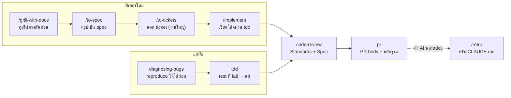

<div align="center">

# Guide การใช้ AI สำหรับ Software Engineer

**ใช้ AI ให้ถูกวิธี ประหยัด token และได้งานที่ถูกตั้งแต่รอบแรก**
ด้วยชุด skill ของ [Matt Pocock](https://github.com/mattpocock/skills) ([AI Hero](https://www.aihero.dev))

[ภาพรวม](#ภาพรวม) · [ก่อนเริ่ม](#สิ่งที่ต้องมีก่อนเริ่ม) · [ติดตั้ง](#การติดตั้ง) · [Skills](#skills-list) · [Workflow](#ai-workflow-ที่ควรทำตาม) · [ตัวอย่างจริง](#ตัวอย่างงานจริง-แอปจองห้องประชุม) · [กฎ](#กฎที่ควรรู้-ทำงานคนเดียวแบบ-end-to-end) · [Obsidian](#best-practice-ให้-ai-จดทุกอย่างลง-obsidian) · [Cheat Sheet](#cheat-sheet)

</div>

---

## สารบัญ

1. [ภาพรวม](#ภาพรวม)
2. [สิ่งที่ต้องมีก่อนเริ่ม](#สิ่งที่ต้องมีก่อนเริ่ม)
3. [การติดตั้ง](#การติดตั้ง)
4. [Skills list](#skills-list)
5. [AI Workflow ที่ควรทำตาม](#ai-workflow-ที่ควรทำตาม)
6. [ตัวอย่างงานจริง: แอปจองห้องประชุม](#ตัวอย่างงานจริง-แอปจองห้องประชุม)
7. [ตัวอย่าง Prompt พร้อมใช้](#ตัวอย่าง-prompt-พร้อมใช้)
8. [กฎที่ควรรู้ (ทำงานคนเดียวแบบ End-to-End)](#กฎที่ควรรู้-ทำงานคนเดียวแบบ-end-to-end)
9. [Best Practice: ให้ AI จดทุกอย่างลง Obsidian](#best-practice-ให้-ai-จดทุกอย่างลง-obsidian)
10. [Cheat Sheet](#cheat-sheet)

---

## ภาพรวม

เป้าหมายของไกด์นี้คือใช้ AI ให้ถูกวิธีและประหยัด token ให้ได้งานที่ถูกตั้งแต่รอบแรก แทนการสั่งแก้ซ้ำจนเปลืองเวลาและเงิน ชุด skill ของ Matt Pocock ที่ engineer ทั่วโลกแนะนำช่วยเรื่องนี้โดยตรง:

| หลักการ | ช่วยประหยัดอย่างไร |
| --- | --- |
| **คุยให้ตรงกันก่อนเขียนโค้ด** | grill 10 นาที ถูกกว่าให้ AI เขียนผิดทั้งฟีเจอร์แล้วรื้อทำใหม่ |
| **ศัพท์กลางใน `GLOSSARY.md`** | AI ใช้คำเดียวแทนคำอธิบายยาว คิดน้อยลง ตอบสั้นลงทุก session |
| **เอกสารใน `docs/` แทนแชทยาว** | เริ่ม session ใหม่ให้ AI อ่านสรุปสั้น ๆ ไม่ต้องลาก context เก่าทั้งก้อน |
| **งานเล็ก ขอบเขตชัด** | 1 ticket = 1 session = 1 PR ระบุโฟลเดอร์ที่แก้ได้ AI จะไม่อ่านทั้ง codebase |
| **TDD และ diagnose แทนการเดา** | test บอกผลทันที ไม่ต้องวนถามว่า "ลองใหม่ได้ไหม" |
| **Context เต็ม → `/handoff` แล้วเริ่มใหม่** | session ยิ่งยาวยิ่งแพง และ AI ยิ่งลืม |

**Skill คืออะไร** — ชุดคำสั่งสำเร็จรูปที่ agent (Claude Code, Codex, Copilot ฯลฯ) โหลดมาใช้เมื่อเจองานประเภทนั้น เหมือนให้ AI ถือ checklist ของวิศวกรอาวุโสติดมือไว้ ชุดนี้ตั้งใจให้เล็ก ประกอบกันได้ และแก้ไขเองได้ ไม่ยึดกระบวนการทั้งหมดไปจากเรา

**ทำไมต้องชุดนี้** — มันแก้ปัญหา 4 ข้อที่เจอบ่อยเวลาใช้ AI เขียนโค้ด:

| ปัญหาที่เจอ | สาเหตุ | Skill ที่แก้ |
| --- | --- | --- |
| AI ทำไม่ตรงกับที่ต้องการ | เราอธิบายไม่ครบ และ AI ไม่ถามกลับ | `/grill-with-docs`, `/grill-me` |
| AI พูดยาว เรียกชื่อสิ่งต่าง ๆ ไม่ตรงกัน | ไม่มีภาษากลางของโปรเจกต์ | `domain-modeling` (สร้าง `GLOSSARY.md` + ADR) |
| โค้ดที่ได้ใช้ไม่ได้จริง | AI ไม่มี feedback loop | `tdd`, `diagnosing-bugs` |
| โค้ดเบสกลายเป็นก้อนโคลน | AI เร่งความซับซ้อนให้โตเร็ว | `codebase-design`, `/improve-codebase-architecture` |

> [!IMPORTANT]
> AI ไม่ได้มาแทนพื้นฐานวิศวกรรม แต่ทำให้พื้นฐานพวกนี้สำคัญขึ้นกว่าเดิม

---

## สิ่งที่ต้องมีก่อนเริ่ม

ต้องใช้ git เป็น เพราะ skill ส่วนใหญ่ทำงานผ่าน branch, commit และไฟล์ Markdown ใน repo

### ความรู้ git ที่ต้องมี

ไม่ต้องเชี่ยวชาญ แต่ต้องอ่านสิ่งที่ AI ทำกับ git ออก และกู้คืนได้เมื่อพลาด:

- [ ] clone, pull, push
- [ ] สร้างและสลับ branch
- [ ] commit และอ่าน diff
- [ ] เปิด PR และรีวิวบน GitHub
- [ ] แก้ merge conflict
- [ ] ย้อนงาน (`revert`, `restore`) เมื่อ AI แก้พัง

ยังไม่คล่อง → ใช้ GitHub Desktop ช่วยดู หรือถาม Claude ให้อธิบายคำสั่งก่อนกดอนุญาต

### โปรแกรมที่ควรติดตั้ง

| หมวด | แนะนำ | ทางเลือก | ใช้กับ AI ยังไง |
| --- | --- | --- | --- |
| AI agent | Claude Code (desktop / CLI) | Codex, Copilot | ตัวรัน skill ทั้งหมด |
| Editor | VS Code, Zed | Cursor, JetBrains | อ่าน diff ที่ AI แก้ก่อน commit |
| Git / GitHub | git + `gh` CLI | GitHub Desktop | `/to-spec`, `/to-tickets`, `pr` ใช้ `gh` เปิด issue และ PR |
| เอกสาร | Obsidian | Notion | เปิดโฟลเดอร์ `docs` ใน repo เป็น vault อ่าน `GLOSSARY.md`, ADR, spec ที่ AI เขียนได้ตรง ๆ |
| ทดสอบ API | Bruno | Postman, Insomnia | Bruno เก็บ request เป็นไฟล์ใน repo ให้ AI อ่านและอัปเดตพร้อมโค้ดได้ |
| API doc | OpenAPI (`openapi.yaml`) + Scalar / Swagger UI | Postman Docs | ให้ AI อัปเดต spec ทุกครั้งที่แก้ endpoint |
| แผนภาพ | Mermaid (ใน Markdown) | Excalidraw | ให้ AI วาด flow / ER diagram แสดงผลใน GitHub และ Obsidian |
| ฐานข้อมูล | DBeaver | TablePlus | ตรวจผล migration ที่ AI เขียน |

ตารางนี้เป็นแค่ข้อแนะนำ เลือกใช้ตัวที่ถนัดได้

### ความรู้เทคนิคที่ต้องมีเอง

AI เขียน Dockerfile, k8s manifest หรือ Kafka consumer ให้ได้ในไม่กี่วินาที แต่ถ้าเราไม่เข้าใจเทคโนโลยีนั้น เราจะตรวจไม่ได้ว่ามันถูกหรือผิด ต้องรู้พอที่จะอ่านงาน AI ออก ตั้งคำถามถูก และตัดสินใจเองได้ ไม่ต้องเชี่ยวชาญทุกตัว เลือกเรียนเฉพาะที่โปรเจกต์ใช้จริง

| เทคโนโลยี | ต้องรู้ขั้นต่ำ | Best practice สั้น ๆ | แหล่งเรียน |
| --- | --- | --- | --- |
| Git | branch, merge, rebase, conflict | commit เล็ก ๆ ข้อความบอก "ทำไม" | [Learn Git Branching](https://learngitbranching.js.org), [Pro Git](https://git-scm.com/book) |
| Docker | image, container, volume, network, compose | multi-stage build, image เล็ก, ห้ามใส่ secret ใน image | [Docker Get Started](https://docs.docker.com/get-started/) |
| Kubernetes | pod, deployment, service, ingress, configmap / secret | ตั้ง resource limit + health probe ทุก deployment | [Kubernetes Basics](https://kubernetes.io/docs/tutorials/kubernetes-basics/) |
| Kafka | topic, partition, consumer group, offset | consumer ต้อง idempotent, ออกแบบ key ให้ลำดับถูก | [Confluent Developer](https://developer.confluent.io), [Kafka Docs](https://kafka.apache.org/documentation/) |
| PostgreSQL / SQL | join, index, transaction, isolation level | query ที่ช้าให้ดู `EXPLAIN` ก่อนเพิ่ม index | [PostgreSQL Docs](https://www.postgresql.org/docs/), [Use The Index, Luke](https://use-the-index-luke.com) |
| REST API / OpenAPI | HTTP method, status code, versioning | เขียน spec ก่อนโค้ด (contract-first) | [OpenAPI Learn](https://learn.openapis.org) |
| React + TypeScript | component, state, hook, type, generic | เปิด `strict` mode, ห้ามใช้ `any` | [react.dev/learn](https://react.dev/learn), [Total TypeScript](https://www.totaltypescript.com) |
| UI component library | design token, accessibility พื้นฐาน | เลือกชุดเดียวทั้งโปรเจกต์ บอก AI ชัด ๆ ว่าใช้ตัวไหน | [shadcn/ui](https://ui.shadcn.com), [MUI](https://mui.com), [Ant Design](https://ant.design) |
| Testing | unit vs integration vs e2e | test พฤติกรรม ไม่ใช่ test ไส้ใน | skill `tdd` (อ่าน SKILL.md ได้เลย), [Playwright](https://playwright.dev) |
| Security | OWASP Top 10, auth vs authz | ตรวจสิทธิ์ฝั่ง server ทุก endpoint | [OWASP Top 10](https://owasp.org/www-project-top-ten/) |
| GitHub Actions (CI/CD) | workflow, job, step, trigger, secrets | รัน test + lint ทุก PR และตั้ง branch protection ให้ merge ไม่ได้ถ้า CI แดง | [GitHub Actions Quickstart](https://docs.github.com/en/actions/quickstart) |
| Tools อื่น ๆ | เช่น Tailwind CSS, GSAP, ORM | อ่าน docs ทางการก่อน แล้วใช้ AI ช่วยอธิบายส่วนที่ไม่เข้าใจ | docs ทางการของแต่ละตัว |

> [!TIP]
> **ว่าง ๆ ลองเล่น GitHub Actions** — สำหรับคนทำงานคนเดียว CI คือ reviewer อัตโนมัติที่ไม่เคยลืมรัน test ลองเริ่มจาก repo ทดลองเล็ก ๆ ก่อน:
>
> ```text
> สร้าง .github/workflows/ci.yml ให้หน่อย รันทุก pull request:
> - backend: go test ./... และ golangci-lint
> - frontend: pnpm install, pnpm typecheck, pnpm test
> อธิบายทุกบรรทัดในไฟล์เป็นภาษาไทยให้ผมเรียนไปด้วย
> แล้วบอกวิธีตั้ง branch protection บน GitHub ให้ merge ไม่ได้ถ้า CI ไม่ผ่าน
> ```

**แหล่งรวมที่ควร bookmark:** [roadmap.sh](https://roadmap.sh) (เส้นทางเรียนแต่ละสาย), [AI Hero](https://www.aihero.dev) (การใช้ AI เขียนโค้ด) และเอกสารทางการของแต่ละเครื่องมือ เชื่อเอกสารทางการมากกว่าบทความหรือคำตอบ AI เสมอ เพราะ AI อาจจำ API เวอร์ชันเก่า

**ใช้ AI เป็นครู ไม่ใช่คนทำแทน** — เจอเทคโนโลยีที่ไม่รู้จัก ให้สั่งแบบนี้ก่อนให้มันเขียนโค้ด:

```text
อธิบาย Kafka consumer group และ offset ให้ผมเข้าใจก่อน ยังไม่ต้องเขียนโค้ด
ยกตัวอย่างจากโปรเจกต์เรา อ้างอิงเอกสารทางการ แล้วถามผมกลับ 3 ข้อเพื่อเช็กว่าผมเข้าใจจริง
```

ต้องการข้อมูลละเอียดจาก docs จริง ใช้ skill `research` ให้สรุปพร้อมแหล่งอ้างอิงลง `docs/` ได้เลย

---

## การติดตั้ง

ติดตั้งครั้งเดียวต่อเครื่อง แล้วรัน setup ครั้งเดียวต่อ repo ใช้เวลาไม่ถึง 5 นาที

1. เข้า [aihero.dev/skills](https://www.aihero.dev/skills) เลื่อนลงล่างสุด แล้วคัดลอกคำสั่งติดตั้งไปรันใน Terminal / CMD
2. เปิด Claude Code ในโฟลเดอร์โปรเจกต์ แล้วรัน `/setup-matt-pocock-skills` (ครั้งเดียวต่อ repo)

---

## Skills list

ตัวที่ติด ★ คือตัวที่ใช้ทุกวัน ที่เหลือใช้เมื่องานใหญ่ขึ้น

### วางแผนและคุยให้ตรงกัน

| Skill | เรียก | ใช้ตอนไหน | ได้อะไร |
| --- | --- | --- | --- |
| ★ grill-with-docs | `/grill-with-docs` | ก่อนเริ่มงานทุกชิ้น | AI ถามคำถามจนชัด + อัปเดต `GLOSSARY.md` และ ADR ไปด้วย |
| grill-me / grilling | `/grill-me` | แผนที่ไม่ใช่โค้ด (เอกสาร, การตัดสินใจ) | แผนที่ผ่านการซักครบทุกกิ่ง |
| to-spec | `/to-spec` | หลัง grill เสร็จ | spec บน issue tracker สรุปจากที่คุยกัน |
| to-tickets | `/to-tickets` | spec ใหญ่เกิน 1 งาน | ticket แบบ tracer-bullet พร้อมลำดับการบล็อก |
| wayfinder | `/wayfinder` | งานใหญ่มากจน 1 session ไม่พอ | แผนที่ decision ticket ไล่ตัดสินทีละข้อ |
| triage | `/triage` | คัดกรอง issue / PR ที่เข้ามา | issue ที่ติด label และมี brief พร้อมให้ agent ทำ |
| prototype | สั่งตรง / AI เลือกเอง | อยากลอง UI หรือ state logic ก่อนทำจริง | ต้นแบบทิ้งได้ (HTML ไฟล์เดียว หรือหลาย UI สลับดูได้) |
| research | สั่งตรง / AI เลือกเอง | ต้องหาข้อมูล API / docs | ไฟล์ Markdown พร้อมแหล่งอ้างอิงใน repo |

### เขียนโค้ดและแก้บั๊ก

| Skill | เรียก | ใช้ตอนไหน | ได้อะไร |
| --- | --- | --- | --- |
| ★ implement | `/implement` | มี spec / ticket แล้ว | โค้ดที่ทำผ่าน `tdd` แล้วปิดด้วย `code-review` ก่อน commit |
| implement-spec | `/implement-spec` | spec ใหญ่ที่แตก ticket แล้ว | หลาย subagent ทำ ticket ขนานกันบน branch เดียว |
| ★ tdd | "do this with TDD" | ทำฟีเจอร์หรือแก้บั๊กทุกครั้ง | วงจร red → green → refactor ทีละ vertical slice |
| ★ diagnosing-bugs | "diagnose this" | บั๊กยาก หรือระบบช้าลง | วงจร reproduce → ย่อเคส → ตั้งสมมติฐาน → ใส่ log → แก้ → regression test |
| codebase-design | AI เลือกเอง | ออกแบบ interface / module | คำศัพท์กลางเรื่อง deep module, seam |
| domain-modeling | AI เลือกเอง | คุยเรื่องชื่อ / ศัพท์ในโปรเจกต์ | `GLOSSARY.md` และ ADR ที่คมขึ้น |
| wizard | สั่งตรง | งานที่คนต้องทำเอง (ตั้ง secret, กดใน dashboard) | bash wizard พาทำทีละขั้น |

### รีวิว ส่งงาน และปรับปรุง

| Skill | เรียก | ใช้ตอนไหน | ได้อะไร |
| --- | --- | --- | --- |
| ★ code-review | "review since main" | ก่อนเปิด PR | รีวิว 2 แกน: Standards (ตามมาตรฐาน repo) + Spec (ตรง issue ไหม) |
| ★ pr | "write the PR body" | เปิด PR | PR body มีสรุป, หลักฐาน before/after, ระดับความเสี่ยง |
| improve-codebase-architecture | `/improve-codebase-architecture` | ทุก 2–3 วัน | รายงาน HTML จุดที่ควร refactor แล้ว grill ต่อจุดที่เลือก |
| retro | `/retro` | จบ session ที่ AI ทำพลาดบ่อย | ข้อเสนอปรับ CLAUDE.md, check, tooling เรียงตามความรุนแรง |
| handoff | `/handoff` | context เต็ม หรือส่งงานต่อ | เอกสารส่งต่อให้ session ใหม่ทำต่อได้ |

---

## AI Workflow ที่ควรทำตาม

งานทุกชิ้นไม่ว่าเริ่มจากฟีเจอร์หรือบั๊ก ต้องมาจบที่ `code-review` และ `pr` เสมอ



- **ฟีเจอร์ใหม่** — grill จน AI เข้าใจ → สรุป spec → แตก ticket เฉพาะงานใหญ่ (งานเล็กข้ามได้) → `/implement` ซึ่งเรียก `tdd` ให้เอง
- **แก้บั๊ก** — สั่ง "diagnose this" ให้ AI ทำบั๊กซ้ำให้ได้ก่อน แล้วล็อกด้วย regression test
- **ก่อนส่ง** — `code-review` เจอปัญหาให้กลับไปแก้แล้วรีวิวใหม่ ผ่านแล้วค่อยให้เขียน PR body
- **งานใหญ่มาก** (หลายสัปดาห์) — เริ่มด้วย `/wayfinder` แทน grill แล้วใช้ `/implement-spec` ให้หลาย subagent ทำขนานกัน

---

## ตัวอย่างงานจริง: แอปจองห้องประชุม

โจทย์: พนักงานจองห้องประชุมผ่านเว็บ ดูว่าห้องว่างไหม และยกเลิกการจองของตัวเองได้ ทำตาม workflow ข้างบนทีละขั้น

แต่ละขั้นมี prompt 2 แบบ:

- **บุคคลทั่วไป** — PO, BA, QA, ฝ่ายธุรกิจ หรือคนที่ไม่ได้เขียนโค้ด บอกแค่เป้าหมายเป็นภาษาคน แล้วให้ AI ถามต่อเอง
- **Engineer** — สำหรับงานจริง ต้องใส่บริบทครบ: ขนาดระบบ, tech stack พร้อม version, integration, functional / non-functional requirement, ข้อจำกัด, เรื่องที่ให้ AI เน้น, ผลลัพธ์ที่ต้องการ และขอบเขตที่ห้ามทำ ยิ่งระบุครบ AI ยิ่งถามลึกและเดาน้อยลง

> [!NOTE]
> ตัวเลขในตัวอย่าง (5 สาขา, 80 ห้อง, p95 < 300 ms ฯลฯ) สมมติขึ้นเพื่อประกอบ ให้เปลี่ยนเป็นค่าจริงของโปรเจกต์ตัวเอง

### 1. Grill — คุยให้ตรงกัน

**บุคคลทั่วไป**

```text
/grill-with-docs อยากทำแอปจองห้องประชุมให้พนักงานในออฟฟิศ จอง ดูห้องว่าง และยกเลิกได้
```

<details>
<summary><b>Engineer</b> (คลิกเพื่อดู prompt เต็ม)</summary>

```text
/grill-with-docs

บริบท:
อยากทำระบบจองห้องประชุมภายในบริษัท แทนการจองผ่าน Excel / LINE
ขนาด: 5 สาขา, ประมาณ 80 ห้อง, ผู้ใช้ 1,500 คน, ช่วงพีค 9:00–10:00 จองพร้อมกันหลายร้อยคน

Tech stack:
- Backend: Go 1.23, chi router, sqlc, REST + JSON
- Frontend: React 18 + TypeScript, Vite, TanStack Query
- Database: PostgreSQL 16
- Auth: SSO ผ่าน OIDC (Azure AD)
- Infra: Docker, Kubernetes on-prem, GitHub Actions
- Notification: อีเมลผ่าน SMTP + job queue

Integration:
- ดึงรายชื่อพนักงานและแผนกจากระบบ HR เดิม (REST API)
- Sync การจองเข้า Outlook Calendar ของผู้จอง

Functional requirements:
- หลายสาขา หลายชั้น หลายห้อง แต่ละห้องมีจำนวนที่นั่งและอุปกรณ์ (จอ, VC)
- ค้นหาห้องว่างตามเวลา จำนวนคน และอุปกรณ์
- จองครั้งเดียว และจองประจำ (รายวัน / รายสัปดาห์)
- ห้ามจองซ้อนเวลาในห้องเดียวกัน
- แก้ไข / ยกเลิก ทั้งครั้งเดียวและทั้งชุด
- Check-in ภายใน 15 นาที ไม่งั้นปล่อยห้องอัตโนมัติ
- สิทธิ์: พนักงาน, เลขา (จองแทนผู้บริหาร), admin สาขา, super admin
- แจ้งเตือนอีเมลก่อนประชุม 15 นาที และเมื่อถูกยกเลิก
- Audit log ทุกการสร้าง / แก้ / ยกเลิก
- รายงานอัตราการใช้ห้องรายเดือน

Non-functional requirements:
- API p95 < 300 ms, uptime 99.5% ในเวลาทำการ
- เก็บเวลาเป็น UTC แสดงเป็น Asia/Bangkok
- เก็บ audit log 1 ปี และต้องแก้ไขไม่ได้
- ปฏิบัติตาม PDPA (ข้อมูลพนักงานใน log ต้อง mask)
- รองรับมือถือ (responsive) ไม่ต้องทำ native app

ข้อจำกัด:
- Deploy บน on-prem เท่านั้น ห้ามใช้ SaaS ภายนอกที่เก็บข้อมูลพนักงาน
- ทีมมี backend 2 คน frontend 1 คน เป้า MVP ใน 6 สัปดาห์

สัมภาษณ์ผมทีละคำถาม ทุกคำถามให้เสนอคำตอบที่แนะนำมาด้วย

เน้นเรื่อง:
- Business rules: จองล่วงหน้าได้กี่วัน, จองได้นานสุดกี่ชั่วโมง, ใครยกเลิกของใครได้
- Edge cases: จองต่อเวลากันพอดี, จองข้ามเที่ยงคืน, จองประจำชนวันหยุด, ห้องปิดปรับปรุง, พนักงานลาออกแต่ยังมีการจองค้าง
- Concurrency และ data consistency: สองคนกดจองพร้อมกัน, กันที่ระดับ database, transaction boundary, idempotency
- Architecture: แบ่ง module (booking, room, notification, identity), อะไรเป็น sync / async
- Integration: HR ล่มทำอย่างไร, sync Outlook พลาดแล้ว retry ยังไง
- Security: RBAC, IDOR (ยกเลิกการจองของคนอื่น), OWASP Top 10, rate limit
- Observability: log, metric, trace ที่ต้องมีตั้งแต่วันแรก
- Rollout: migrate ข้อมูลจาก Excel เดิม, เปิดทีละสาขาด้วย feature flag

ผลลัพธ์ที่ต้องการ:
- อัปเดต GLOSSARY.md ทุกครั้งที่เกิดศัพท์ใหม่
- เขียน ADR สำหรับการตัดสินใจที่ย้อนกลับยาก
- จบด้วยรายการ open questions ที่ต้องถามฝ่ายธุรกิจ

ห้าม: เขียนโค้ด หรือสร้างไฟล์นอกจาก docs/
```

</details>

AI จะถามกลับทีละข้อ แบบบุคคลทั่วไปจะได้คำถามเช่น "จองล่วงหน้าได้กี่วัน" ส่วนแบบ Engineer จะได้คำถามที่ลึกกว่า:

- ถ้าสองคนกดจองห้องเดียวกันพร้อมกัน จะกันด้วย constraint ใน PostgreSQL หรือ lock ในแอป?
- จองประจำแล้วเจอวันหยุด จะข้ามหรือยกเลิกทั้งชุด?
- เก็บเวลาเป็น UTC แล้วแสดงเป็นเวลาไทย ใช่ไหม?
- เลขายกเลิกการจองของคนอื่นได้ทุกห้อง หรือเฉพาะสาขาตัวเอง?

ผลคือ `GLOSSARY.md` ที่นิยามศัพท์กลาง และ ADR สำหรับการตัดสินใจใหญ่:

```markdown
- **Room** — ห้องประชุม มีชื่อ สาขา และจำนวนที่นั่ง
- **Booking** — การจอง 1 ครั้ง = Room + ช่วงเวลา + ผู้จอง
- **Series** — ชุด Booking ที่เกิดจากการจองประจำ
- **Conflict** — Booking สองอันใน Room เดียวกันที่เวลาทับกัน (ห้ามเกิด)
```

### 2. Spec และ ticket

**บุคคลทั่วไป**

```text
/to-spec
/to-tickets
```

<details>
<summary><b>Engineer</b> (คลิกเพื่อดู prompt เต็ม)</summary>

```text
/to-spec

เขียน spec จากที่ grill กันมา ใช้ศัพท์ตาม GLOSSARY.md เท่านั้น แบ่งหัวข้อ:
1. Problem, Goals, Non-goals
2. Data model: ตาราง, column, type, index, constraint
   (ระบุว่ากันจองซ้อนด้วย constraint อะไร) + ER diagram เป็น Mermaid
3. State machine ของ Booking (draft, confirmed, checked-in, released, cancelled)
4. API: ตาราง method, path, สิทธิ์, request, response, error code
5. RBAC matrix: role × action
6. Integration: HR, Outlook — timeout, retry, fallback
7. Non-functional: performance, audit, PDPA, observability
8. Rollout: migration จาก Excel, feature flag, แผน rollback
9. Risks และ open questions

อ้างอิง ADR ที่เกี่ยวข้องทุกจุด ห้ามเติม requirement ที่ไม่ได้คุยกัน
```

```text
/to-tickets

แตก spec เป็น vertical slice ที่จบใน 1 PR (ไม่เกิน ~400 บรรทัด)
ticket แรกต้องเป็น walking skeleton: API health check + หน้าเว็บ + CI + deploy ขึ้น staging

แต่ละ ticket ต้องมี:
- เป้าหมาย 1 บรรทัด
- Acceptance criteria แบบ Given / When / Then
- รายการ test: unit, integration, e2e
- Module / โฟลเดอร์ที่คาดว่าจะแก้
- Blocked by
- ขนาด S / M / L
- label ตามที่ตั้งไว้ใน setup
```

</details>

ได้ issue บน GitHub เช่น #1 ดูรายการห้อง, #2 สร้าง Booking (blocked by #1), #3 ยกเลิก Booking (blocked by #2)

### 3. Prototype (ถ้ายังไม่แน่ใจ)

**บุคคลทั่วไป**

```text
ทำ prototype หน้าตารางห้อง 3 แบบให้เลือก
```

<details>
<summary><b>Engineer</b> (คลิกเพื่อดู prompt เต็ม)</summary>

```text
ทำ prototype เป็น HTML ไฟล์เดียวใน prototypes/series-state.html
เพื่อเช็กว่า state model ของ Series ใน spec ถูกไหม

ต้องลองได้:
- สร้างจองประจำทุกวันจันทร์ 8 สัปดาห์
- ยกเลิก 1 วัน / ยกเลิกตั้งแต่วันนี้เป็นต้นไป / ยกเลิกทั้งชุด
- ย้ายเวลาเฉพาะวัน แล้วไปชนการจองอื่น
- วันหยุดคั่นกลางชุด
- ไม่ check-in จนห้องถูกปล่อย

แสดง state ของทุก Booking และ log ของ event ทุกครั้งที่เปลี่ยน
เป็นโค้ดทิ้ง ห้าม import เข้าแอปจริง ไม่ต้องต่อ backend
ลองเสร็จแล้วสรุปว่า spec ต้องแก้ตรงไหน
```

</details>

### 4. Implement ด้วย TDD

**บุคคลทั่วไป**

```text
/implement ทำ ticket #2 สร้าง Booking
```

<details>
<summary><b>Engineer</b> (คลิกเพื่อดู prompt เต็ม)</summary>

```text
/implement ticket #2 สร้าง Booking

บริบท: อ่าน spec ใน issue #2, docs/adr/003-prevent-double-booking.md และ GLOSSARY.md ก่อนเริ่ม

ลำดับ TDD (เขียน test ทีละตัว ให้ fail ก่อนแล้วค่อยทำให้ผ่าน):
1. จองห้องว่าง → 201 พร้อม Booking
2. จองทับเวลา → 409 BOOKING_CONFLICT
3. จองต่อเวลากันพอดี (10:00–11:00 แล้ว 11:00–12:00) → 201
4. สอง request พร้อมกัน → สำเร็จแค่ 1
5. start >= end, เกิน 8 ชั่วโมง, เวลาในอดีต → 422
6. คนไม่มีสิทธิ์จองห้องสาขาอื่น → 403

ข้อกำหนดทางเทคนิค:
- Integration test กับ PostgreSQL จริง (testcontainers) ห้าม mock database
- Migration ต้องมี up และ down
- กันจองซ้อนด้วย EXCLUDE USING gist (room_id WITH =, during WITH &&)
  แล้ว map SQLSTATE 23P01 → 409 BOOKING_CONFLICT
- เก็บเวลาเป็น tstzrange แบบ [) ใน UTC
- รองรับ header Idempotency-Key กันกดซ้ำ
- เขียน audit log ใน transaction เดียวกับการจอง
- Error response ตามรูปแบบที่มีอยู่ใน internal/httpx
- Frontend: ฟอร์มจองใช้ TanStack Query, แสดงข้อความชัดเจนเมื่อเจอ 409

เอกสาร:
- อัปเดต api/openapi.yaml ให้ตรงกับโค้ด
- เพิ่ม request ใน bruno/bookings/ ครบทุกเคสด้านบน

Quality gate (ต้องผ่านทั้งหมด):
- go test ./... และ golangci-lint run
- pnpm typecheck และ pnpm test

ขอบเขต:
- แก้ได้เฉพาะ internal/booking, migrations/, web/src/features/booking, api/, bruno/
- ห้ามเพิ่ม dependency ใหม่โดยไม่ถามก่อน
- หยุดก่อน commit แล้วสรุป diff, สิ่งที่ยังไม่ได้ทำ และความเสี่ยง
```

</details>

เสร็จแล้วเปิด Bruno ยิง `POST /bookings` ดูด้วยตาตัวเองอีกรอบ

### 5. เจอบั๊กระหว่างทาง

**บุคคลทั่วไป**

```text
diagnose this: จองห้องต่อเวลากันไม่ได้ ขึ้นว่าห้องไม่ว่าง
```

<details>
<summary><b>Engineer</b> (คลิกเพื่อดู prompt เต็ม)</summary>

```text
diagnose this

อาการ: จอง 11:00–12:00 ต่อจาก 10:00–11:00 ห้องเดียวกัน แล้วได้ 409 BOOKING_CONFLICT
คาดหวัง: 201 เพราะเวลาไม่ทับกัน
ความถี่: เกิดทุกครั้ง เริ่มหลัง merge PR #14
ทำซ้ำ:
  1. รัน bruno/bookings/back-to-back.bru
  2. request ที่สองได้ 409
Log / trace id: <วาง log และ trace id>
Environment: local + staging, Go 1.23, PostgreSQL 16
ที่ลองแล้ว: เช็ก timezone ทั้ง client และ server เป็น UTC แล้ว

วิธีทำงาน:
- เขียน test ที่ fail ให้ได้ก่อน ห้ามแก้แบบเดา
- ตั้งสมมติฐานหลายข้อ แล้วพิสูจน์ทีละข้อ
- ห้ามแก้ schema หรือปิด constraint โดยไม่ถามก่อน

สิ่งที่ต้องส่ง:
- สาเหตุที่แท้จริง พร้อมหลักฐาน
- การแก้ + regression test
- หาจุดอื่นใน codebase ที่มี pattern เดียวกัน
```

</details>

AI ทำบั๊กซ้ำด้วย test แล้วเจอว่าเทียบเวลาด้วย `<=` แทน `<` พอแก้แล้ว test นี้จะอยู่ต่อเป็น regression test

### 6. รีวิวและเปิด PR

**บุคคลทั่วไป**

```text
review since main
เขียน PR body ให้หน่อย
```

<details>
<summary><b>Engineer</b> (คลิกเพื่อดู prompt เต็ม)</summary>

```text
review since main เทียบกับ issue #2 และ ADR-003

เช็กเรื่อง:
- ทำครบ acceptance criteria ทุกข้อไหม
- Concurrency: race condition, transaction boundary, deadlock
- Security: SQL injection, IDOR, RBAC ต่อ endpoint, ข้อมูลส่วนบุคคลใน log
- Error code และ response ตรง openapi.yaml
- Migration: lock ตารางนานไหม, ย้อนกลับได้ไหม
- Performance: N+1 query, index ที่ใช้จริง
- Test: edge case ไหนยังไม่มี test
- ตั้งชื่อตาม GLOSSARY.md

รายงานเรียงตามความรุนแรง พร้อม file:line และวิธีแก้
```

```text
เขียน PR body ให้มี:
- สรุป 2–3 บรรทัด + ลิงก์ issue #2
- Sequence diagram flow การจองเป็น Mermaid
- Screenshot หน้าจอง before / after
- หลักฐาน test: คำสั่งที่รันและผลลัพธ์
- ขั้นตอนทดสอบเองด้วย Bruno สำหรับ reviewer
- Migration และแผน rollback
- Feature flag ที่ใช้ (ถ้ามี)
- ระดับความเสี่ยง: one-way / two-way door และ blast radius
- สิ่งที่ตั้งใจยังไม่ทำ (ย้ายไป ticket ไหน)
```

</details>

จบ 1 ticket จะมีใน repo: โค้ด + test, `GLOSSARY.md`, `openapi.yaml`, ไฟล์ Bruno และ PR ทุกอย่างเปิดดูใน Obsidian หรือ VS Code ได้

---

## ตัวอย่าง Prompt พร้อมใช้

คัดลอกแล้วแก้ส่วนใน `<...>` ให้ตรงงาน พิมพ์ไทยก็ได้ AI เข้าใจ

| สถานการณ์ | Prompt |
| --- | --- |
| เริ่มฟีเจอร์ใหม่ | `/grill-with-docs อยากเพิ่ม <ฟีเจอร์> ให้ <กลุ่มผู้ใช้> เพราะ <เหตุผล> ถามทีละข้อจนกว่าจะชัด` |
| สรุปเป็น spec และ ticket | `/to-spec` แล้วตามด้วย `/to-tickets` |
| ลงมือทำ | `/implement ทำ ticket #<เลข> ตาม spec ใช้ TDD และหยุดให้ผมดูก่อน commit` |
| แก้บั๊ก | `diagnose this: <อาการ> เกิดตอน <ขั้นตอนทำซ้ำ> error คือ <วาง log> — สร้าง test ที่ fail ให้ได้ก่อนแก้` |
| รีวิวก่อนเปิด PR | `review since main เทียบกับ issue #<เลข>` แล้วตามด้วย `เขียน PR body ให้หน่อย` |
| ลอง UI ก่อนทำจริง | `ทำ prototype หน้า <ชื่อหน้า> สัก 3 แบบที่ต่างกันมาก ให้สลับดูได้ใน route เดียว` |
| ไม่แน่ใจว่าจะเริ่มจากตรงไหน | `/ask-matt ผมได้รับ issue นี้มา <วางลิงก์> ควรใช้ขั้นตอนไหน` |

---

## กฎที่ควรรู้ (ทำงานคนเดียวแบบ End-to-End)

เมื่อคนเดียวรับงานตั้งแต่ requirement จน deploy จะไม่มีใครคอยจับผิดให้ กฎชุดนี้จึงต้องทำหน้าที่แทน reviewer AI เขียนโค้ดให้ก็จริง แต่คุณคือเจ้าของทุกบรรทัด และต้องอธิบายได้ทุกบรรทัด

### ข้อห้าม

| ห้ามทำ | เพราะ | ทำแทน |
| --- | --- | --- |
| ข้าม grill แล้วสั่ง AI เขียนโค้ดเลย | AI เดา requirement และไม่มีใครทัก | `/grill-with-docs` ทุกงานที่ใหญ่กว่าแก้บรรทัดเดียว |
| ใส่ secret, รหัสผ่าน, token, ข้อมูลลูกค้าจริงใน prompt | ข้อมูลออกนอกองค์กร ผิด PDPA | `.env` และข้อมูลทดสอบ |
| กดอนุญาตคำสั่งที่ไม่เข้าใจ (`push --force`, `rm -rf`, `DROP TABLE`) | ย้อนไม่ได้ | ถาม AI ให้อธิบายก่อนกด |
| ให้ AI commit / push เข้า `main` ตรง ๆ | ไม่มีจุดตรวจก่อนขึ้นจริง | branch + PR ทุกครั้ง แม้ทำคนเดียว |
| Merge โดยไม่อ่าน diff เอง | AI review ผ่าน ≠ ถูก | อ่าน diff เองทุกไฟล์ |
| ปิด test ที่ fail หรือแก้ test ให้ผ่านแทนแก้โค้ด | ซ่อนบั๊กไว้รอระเบิด | `diagnosing-bugs` หาสาเหตุจริง |
| ปล่อย AI แก้นอกขอบเขต ticket หรือเพิ่ม dependency เอง | diff บวม รีวิวไม่ไหว | ระบุโฟลเดอร์ที่แก้ได้ใน prompt |
| เชื่อ AI เรื่อง API / library / เวอร์ชันโดยไม่เช็ก | AI อาจจำข้อมูลเก่าหรือแต่งขึ้นเอง | ใช้ `research` อ่าน docs จริง |
| Deploy production โดยไม่มีแผน rollback | พังแล้วไม่มีคนช่วย | เขียน rollback ใน PR body ก่อน deploy |
| ทำต่อใน session ที่ context ยาวจน AI เริ่มลืม | AI ตอบขัดกับที่ตกลงไว้ | `/handoff` แล้วเริ่ม session ใหม่ |

### ต้องทำทุกครั้ง

- [ ] Grill ก่อนเริ่ม และจดศัพท์ลง `GLOSSARY.md`
- [ ] เขียน test ที่ fail ก่อนเขียนโค้ด (ทั้งฟีเจอร์และบั๊ก)
- [ ] 1 ticket = 1 branch = 1 PR เล็ก ๆ
- [ ] รัน `code-review` แล้วพักสักครู่ กลับมาอ่าน diff เองเหมือนเป็น reviewer อีกคน
- [ ] Quality gate ผ่านทั้งในเครื่องและ CI (test, lint, typecheck)
- [ ] อัปเดต ADR, `openapi.yaml`, ไฟล์ Bruno ใน PR เดียวกับโค้ด
- [ ] PR body มีหลักฐานว่าใช้ได้ และแผน rollback
- [ ] จบ session ที่ AI พลาดบ่อย → `/retro` แล้วแก้ `CLAUDE.md` / `AGENTS.md`

### ไม่มี reviewer ใช้อะไรแทน

- **AI เป็น reviewer คนแรก** — `code-review` ตรวจทั้ง Standards และ Spec
- **ตัวเราเป็น reviewer คนที่สอง** — อ่าน diff หลังพัก ไม่อ่านต่อทันทีที่เขียนเสร็จ
- **เครื่องมือกันพลาด** — CI บล็อก merge เมื่อ test ไม่ผ่าน, branch protection บน `main`, skill `git-guardrails-claude-code` ตั้ง hook บล็อกคำสั่ง git อันตราย
- **งานเสี่ยงสูงต้องมีคนดูอีกคนเสมอ** — migration บน production, auth / สิทธิ์, การเงิน, ข้อมูลส่วนบุคคล แม้ปกติจะทำคนเดียว

---

## Best Practice: ให้ AI จดทุกอย่างลง Obsidian

AI ลืมทุกอย่างเมื่อจบ session และคนที่ไม่ได้อ่านแชทจะไม่รู้ว่า AI ทำอะไรไป วิธีแก้คือให้ AI เขียนบันทึกลงโฟลเดอร์ `docs/` ใน repo (เปิดเป็น Obsidian vault) ทุกครั้ง และให้ AI อ่านโฟลเดอร์นี้ก่อนเริ่มงานรอบถัดไป คนอ่านได้ AI ก็อ่านได้

### 1. เริ่มจากศูนย์: สร้างโฟลเดอร์โปรเจกต์และ vault (สำหรับมือใหม่)

ศัพท์ 3 คำที่ต้องรู้ก่อน:

- **โฟลเดอร์โปรเจกต์ (repo)** — โฟลเดอร์หลักของงานหนึ่งชิ้น เก็บทั้งโค้ดและเอกสาร ตั้งชื่อภาษาอังกฤษตัวเล็ก คั่นด้วย `-` ไม่มีเว้นวรรค เช่น `meeting-room-booking`
- **`docs/`** — โฟลเดอร์ย่อยชื่อ `docs` ที่อยู่ข้างในโฟลเดอร์โปรเจกต์ เก็บเอกสารทั้งหมด (เครื่องหมาย `/` ท้ายชื่อแปลว่าเป็นโฟลเดอร์)
- **Vault** — คำของ Obsidian แปลว่า "โฟลเดอร์ที่ Obsidian เปิดอ่าน" ไม่ใช่ไฟล์พิเศษ เราจะให้ Obsidian เปิดโฟลเดอร์ `docs` เป็น vault

ขั้นตอน (ทำครั้งเดียวต่อโปรเจกต์):

1. สร้างโฟลเดอร์กลางเก็บทุกโปรเจกต์ ชื่อ `Projects` — Windows: `C:\Projects\` · Mac: `~/Projects/` (อย่าวางใน Desktop หรือ OneDrive และอย่าใช้ชื่อภาษาไทยหรือเว้นวรรคใน path)
2. ข้างในสร้างโฟลเดอร์โปรเจกต์ เช่น `C:\Projects\meeting-room-booking\` ถ้ามี repo บน GitHub อยู่แล้ว ให้ `git clone` ลงใน `Projects` แทนการสร้างเอง
3. ข้างในโฟลเดอร์โปรเจกต์ สร้างโฟลเดอร์ `docs` → `C:\Projects\meeting-room-booking\docs\`
4. เปิด Obsidian → กด **Open folder as vault** → เลือกโฟลเดอร์ `docs`
5. เปิด Claude Code ที่โฟลเดอร์โปรเจกต์ (`meeting-room-booking` ไม่ใช่ `docs`) แล้วสั่งให้ AI สร้างที่เหลือให้:

```text
สร้างโครงสร้างเอกสารใน docs/ ให้หน่อย:
STATUS.md, GLOSSARY.md, adr/, specs/, sessions/, runbooks/, templates/session.md
ใส่คำอธิบายสั้น ๆ ในแต่ละไฟล์ว่าเก็บอะไร
แล้วเพิ่ม Documentation rules ลง CLAUDE.md ที่ root ของโปรเจกต์
```

เสร็จแล้วหน้าตาจะเป็นแบบนี้:

```text
C:\Projects\
└── meeting-room-booking\     ← โฟลเดอร์โปรเจกต์: เปิด Claude Code ที่นี่
    ├── CLAUDE.md              ← กฎที่ AI อ่านทุก session
    ├── docs\                  ← เปิดใน Obsidian (= vault)
    ├── backend\               ← โค้ด (มีเมื่อเริ่มเขียนโค้ด)
    └── web\
```

> [!WARNING]
> 1 โปรเจกต์ = 1 vault อย่าเปิด `Projects` ทั้งก้อนเป็น vault เดียว ไม่งั้นเอกสารหลายงานจะปนกัน

### 2. โครงสร้างข้างใน docs/

```text
docs/                    ← เปิดโฟลเดอร์นี้ใน Obsidian
├── STATUS.md            สถานะล่าสุด: เสร็จอะไร ค้างอะไร ต่อไปทำอะไร
├── GLOSSARY.md          ศัพท์กลาง (grill-with-docs เขียนให้)
├── adr/                 การตัดสินใจที่ย้อนกลับยาก
├── specs/               spec แต่ละฟีเจอร์
├── sessions/            บันทึกการทำงานทุก session
│   └── 2026-10-27-booking-conflict.md
└── runbooks/            วิธี deploy, rollback, แก้ปัญหาที่เจอบ่อย
```

ตอนรัน `/setup-matt-pocock-skills` แล้วมันถามว่าจะเก็บเอกสารที่ไหน → ตอบ `docs/` ทุกอย่างจะมารวมที่เดียว Commit โฟลเดอร์นี้เข้า git ด้วย (ยกเว้น `.obsidian/workspace.json`)

### 3. แอบใส่กฎไว้ใน CLAUDE.md (ทำครั้งเดียว ได้ผลทุก session)

วางบล็อกนี้ไว้ใน `CLAUDE.md` (หรือ `AGENTS.md`) ที่ root ของ repo AI จะอ่านทุกครั้งที่เปิด session คนที่ลืมสั่งก็ยังได้เอกสาร ไฟล์ตัวอย่างอยู่ที่ [`templates/CLAUDE.md`](templates/CLAUDE.md)

```markdown
## Documentation rules

ก่อนเริ่มงาน:
- อ่าน docs/STATUS.md, docs/GLOSSARY.md และไฟล์ล่าสุดใน docs/sessions/
- ถ้างานเกี่ยวกับฟีเจอร์ไหน อ่าน docs/specs/ และ docs/adr/ ที่เกี่ยวข้องก่อน

ระหว่างทำ:
- ตัดสินใจเรื่องที่ย้อนกลับยาก → เขียน ADR ใน docs/adr/
- เจอศัพท์ใหม่ → เพิ่มใน docs/GLOSSARY.md
- เอกสารไม่ตรงกับโค้ด → แก้เอกสารให้ตรง และบอกผม

จบงานทุกครั้ง (ก่อน commit):
- สร้าง docs/sessions/YYYY-MM-DD-<หัวข้อ>.md ตาม docs/templates/session.md
- อัปเดต docs/STATUS.md
- ใช้ [[wikilink]] ลิงก์ไป ADR, spec และศัพท์ใน GLOSSARY

รูปแบบ:
- เนื้อหาภาษาไทย ชื่อไฟล์ภาษาอังกฤษตัวเล็กคั่นด้วย -
- ห้ามลบบันทึกเก่า ถ้าข้อมูลเปลี่ยนให้แก้พร้อมระบุวันที่
- ห้ามใส่ secret หรือข้อมูลลูกค้าจริงในเอกสาร
```

### 4. Template บันทึก session

เก็บไว้ที่ `docs/templates/session.md` (ตั้งเป็น template ของ Obsidian ได้ด้วย เผื่อคนเขียนเอง) ไฟล์ตัวอย่างอยู่ที่ [`templates/session.md`](templates/session.md)

```markdown
---
date: 2026-10-27
ticket: "#2"
status: done        # done | in-progress | blocked
---
# กันจองห้องซ้อนเวลา

## ทำอะไรไป
## ไฟล์ที่แก้
## ตัดสินใจอะไร เพราะอะไร   (ลิงก์ [[adr/003-prevent-double-booking]])
## ทดสอบอย่างไร ผลเป็นอย่างไร
## ค้าง / ต้องทำต่อ
## สิ่งที่ AI รอบหน้าควรรู้
```

### 5. Prompt สำหรับเอกสาร

| สถานการณ์ | Prompt |
| --- | --- |
| เริ่ม session ใหม่ ให้ AI อ่านต่อจากครั้งก่อน | `อ่าน docs/STATUS.md และ session ล่าสุดใน docs/sessions/ ก่อน สรุปให้ผมฟังว่างานค้างอยู่ตรงไหน มีอะไรต้องระวัง แล้วรอผมยืนยันก่อนทำต่อ` |
| จบงาน (ถ้ายังไม่ได้ตั้งกฎใน CLAUDE.md) | `ก่อนจบ: บันทึกสิ่งที่ทำลง docs/sessions/ ตาม template อัปเดต docs/STATUS.md และลิงก์ ADR / spec ที่เกี่ยวข้อง เขียนให้คนที่ไม่ได้อ่านแชทนี้เข้าใจได้` |
| เอกสารเก่าไม่ตรงกับโค้ดแล้ว | `docs/specs/booking.md ไม่ตรงกับโค้ดปัจจุบัน เทียบกับโค้ดแล้วแก้เอกสารให้ตรง ห้ามแก้โค้ด แล้วสรุปว่าแก้อะไรไปบ้าง` |
| รับงานต่อจากคนอื่น / กลับมาหลังหายไปนาน | `อ่านทุกอย่างใน docs/ แล้วอธิบายระบบนี้ให้ผมเหมือนคนเพิ่งเข้าทีม บอกด้วยว่าเอกสารตรงไหนขัดกันหรือดูเก่า` |

### 6. เคล็ดลับ Obsidian

- **Graph view** — เห็นว่า session ไหนเชื่อมกับ ADR และ spec ไหน เพราะ AI ใช้ `[[wikilink]]`
- **Plugin Dataview** — ทำตาราง session ที่ `status: blocked` อัตโนมัติจาก frontmatter
- **อ่าน diff เอกสารใน PR** — เอกสารเปลี่ยนพร้อมโค้ดเสมอ ถ้า PR ไม่มีไฟล์ใน `docs/` เลย แปลว่า AI ลืมจด
- **คู่กับ `/handoff`** — handoff ใช้ส่งต่อกลางคันทันที ส่วน session log เก็บไว้อ้างอิงระยะยาว

---

## Cheat Sheet

| อยาก… | พิมพ์ |
| --- | --- |
| เริ่มใช้ใน repo ใหม่ | `/setup-matt-pocock-skills` |
| ไม่รู้จะใช้ skill ไหน | `/ask-matt` |
| คุยให้ตรงกันก่อนเริ่ม | `/grill-with-docs` |
| เปลี่ยนที่คุยเป็น spec / ticket | `/to-spec` → `/to-tickets` |
| ลงมือเขียนโค้ด | `/implement` |
| เขียนแบบ test-first | "use TDD" |
| แก้บั๊กยาก | "diagnose this" |
| ลองไอเดีย UI | "prototype …" |
| รีวิวก่อนส่ง | "review since main" |
| เขียน PR body | "write the PR body" |
| ส่งงานต่อ session ใหม่ | `/handoff` |
| ปรับปรุงหลัง session แย่ ๆ | `/retro` |
| ตรวจสุขภาพ codebase | `/improve-codebase-architecture` |

---

## แหล่งอ้างอิง

- [mattpocock/skills — README](https://github.com/mattpocock/skills) (plugin v1.3.1)
- [AI Hero — newsletter เรื่อง skills](https://www.aihero.dev/s/skills-newsletter)

<div align="center">
<sub>อัปเดตล่าสุด 27 ต.ค. 2026 · พบจุดผิดหรืออยากเพิ่มเนื้อหา เปิด issue หรือ PR ได้เลย</sub>
</div>
